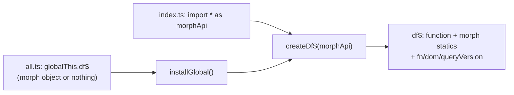
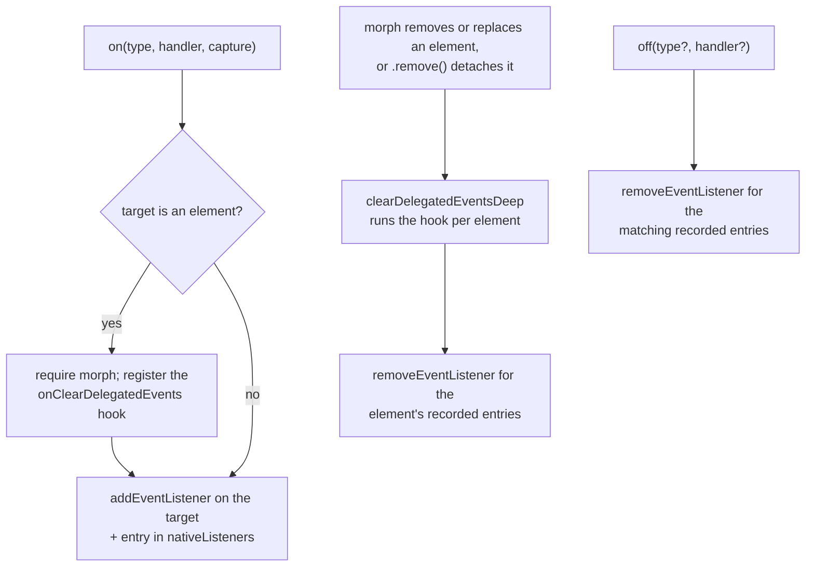

# defuss-query architecture

What this package is, why it is shaped the way it is, and where the seams are. Read this before changing `src/`; the README is the public contract and stays normative for behavior.

## 1. Purpose and design philosophy

defuss-query is a tiny, native-DOM, Array-based, jQuery-shaped facade over the defuss-morph engine. Code written in the jQuery idiom (`df$(".card").addClass("ready").on("click", ...)`) runs directly against the morph engine the rest of defuss uses, with no second reconciler and no second mental model.

The philosophy is a **deliberate subset, not a jQuery clone**:

- Native CSS selectors only (`querySelectorAll`, `matches`). There is no selector engine.
- No AJAX, no Deferred or promise framework, no reactive store, no effects. State and asynchrony stay with the caller, expressed with platform primitives.
- One runtime peer dependency: `defuss-morph ^0.2.0`. Parsing, rendering, reconciliation, cleanup and transitions are delegated to it. Query never embeds, forks or patches the engine; inherited limitations (SVG, MathML and template reconciliation) stay inherited and documented.
- Explicitness over magic: snapshot collections (no live NodeLists, no hidden requery), no `.end()` stack, no thenable collection, no implicit `px`, no JSON coercion in `.data()`.

## 2. The dual nature of `df$`

`df$` is both a **callable factory** that creates `DfQuery` selections and the **morph API namespace** (`df$.morph(...)`, `df$.renderMarkup(...)` and the other morph exports). Two constructors in `src/query.ts` produce this value:

`createDf$(morphApi)` builds the function, then **copies every own key** of the morph API onto it with `defineProperty`. It skips the intrinsic `Function` slots (`name`, `length`, `prototype`, `caller`, `arguments`) and query's reserved slots (`fn`, `dom`, `queryVersion`), so the result stays a well-formed function. `df$.fn` is `DfQuery.prototype`, `df$.dom` is the structural adapter, and a `Symbol.for("defuss-query.factory")` brand marks the function.

`installGlobal()` implements the **global upgrade contract**, one rule per state of the existing global:

| Existing `globalThis.df$` | Result |
| --- | --- |
| A branded query function | Returned unchanged, so a second query bundle is a no-op |
| An unrelated function | Throws; someone else's global is never destroyed silently |
| The plain morph object (morph loaded first) | Its properties are folded into a new callable; morph's function identities survive |
| Nothing (query loaded first) | A callable over an empty object: selectors work at once, structural calls throw "load defuss-morph" until morph fills the global |

The query-first order requires morph 0.1.1 or later, whose loader keeps a function-valued `df$`; older builds overwrite it.

Dependency injection through `createDf$` (exported from `defuss-query/core`) keeps the core free of globals and lets consumers supply their own morph instance. The alternative, importing morph inside the core, would force the CDN bundle to embed a second engine copy next to the one the page already loaded.

## 3. Collection semantics: `DfQuery extends Array`

`DfQuery<T>` is a real `Array` subclass, not an array-like wrapper, so every native array method works and `Array.isArray` holds.

- **Snapshot membership:** the constructor dedupes through a `Set` and pushes in stable encounter order. It pushes in a loop instead of spreading, which avoids argument-count limits on large NodeLists. Membership is fixed at construction; there is no live requery.
- **`Symbol.species` is `Array`:** without it, `map`, `slice` and `flat` would call the `DfQuery` constructor with Array's numeric length argument and break. Species-based methods therefore return plain arrays; only the overridden `find` and `filter` return selections.
- **jQuery-style `each`:** `(index, element)` argument order with `this` bound to the element, and `return false` breaks. This differs from native `forEach` on purpose, to match jQuery habits.
- **Return-shape rule:** traversal (`find(css)`, `parent`, `children`, `closest`, `next`, `prev`, `eq`, `first`, `last`) returns a **new** selection; setters (`attr`, `prop`, `css`, class, value and content methods, `on`, `off`, `trigger`) return **`this`** for chaining.
- Because it is a real Array, native mutators such as `.push()` can defeat the initial dedupe. That is accepted: managed selections come from the factory and the traversal methods, and raw Array access is the escape hatch.

## 4. The structural adapter (`src/dom.ts`)

Morph exposes parse, render, reconcile and lifecycle primitives but **no insert or remove primitives**; it only morphs content into an existing element. Query needs exact operations (`append`, `prepend`, `before`, `after`, `replaceWith`, `remove`, Text writes), so `createDomAdapter(api)` bridges the gap. It is an adapter, not a second reconciler:

| Delegated to morph | Done natively in the adapter |
| --- | --- |
| `htmlStringToVNodes` (HTML parsing, with table and select wrapper fix-ups) | `insertBefore` and `removeChild` for exact positions |
| `getRenderer(doc).createElement` and `createTextNode` (VNodes become DOM nodes) | `cloneNode(true)` for multi-target copies |
| `morph()` reconciliation, diff mode, transitions | `nodeValue` writes for Text and CDATA targets |
| Cleanup: `clearDelegatedEventsDeep` on removal, which also runs the `onClearDelegatedEvents` hooks | Batch validation: inserting an ancestor into its descendant is rejected before any write |
| Lifecycle: `handleLifecycleEventsForOnMount` after each insert | Live NodeList and DocumentFragment snapshots before the first write |

Key details:

- `rootOf(el)` implements morph's shadow rule: regular elements with an open `shadowRoot` address the shadow root; custom-element hosts (tag name contains `-`) keep light-DOM targeting.
- Every document access goes through `documentOf()` or `ownerDocument` and the document's own realm constructors (`DOMParser`, `FormData`, `CustomEvent`), so iframes and other documents work and no global realm is assumed.
- The adapter is shaped so it can **move upstream into morph** later without changing the chain API; `df$.dom` exposes it publicly today.

## 5. Events

Every `.on()` listener is a native `addEventListener` call on its target, for elements and for other EventTargets alike. A module-level `WeakMap<EventTarget, Listener[]>` (`nativeListeners`) records what `.on()` added, so `.off()` removes exactly those listeners and nothing else.

Why not morph's delegated registry: delegation replays the event path from a root, so a delegated handler runs after its ancestors' handlers, an ancestor's `stopPropagation()` cancels it, non-bubbling events never reach it and `event.currentTarget` is the delegation root. Native listeners have none of these differences; the browser suite verifies all four behaviors in Chromium (`suite.browser.test.ts`, the "on(): native" cases).

- The cleanup hook ties listener lifetime to morph's removal path: morphing an element in place keeps its listeners, removal clears them, and a moved element keeps them. Morph versions without `onClearDelegatedEvents` (0.1.1 and older) still run `.on()`; listeners then outlive removal, which is harmless once the element is detached.
- `.on()` accepts `capture` only; any other option key throws, so unsupported jQuery and native options fail loudly instead of being half-emulated. An identical `(type, handler, capture)` triple registers once, mirroring `addEventListener`.
- `.trigger(type, detail)` dispatches a fresh `CustomEvent` built in the target's realm (`bubbles: true`, `cancelable: true`, `composed: false`). It does not emulate native activation, trusted input or default actions.

## 6. Entry points and builds

| Entry | File | Contract |
| --- | --- | --- |
| Library | `src/index.ts` | Imports the `defuss-morph` peer and passes it to `createDf$`. No side effects on import: no global writes, no `document` reads, safe for server-side imports. Shipped as ESM and CJS with declarations for each. |
| Core | `src/query.ts` | `createDf$`, `installGlobal`, `DfQuery`, the adapter factory; no runtime morph import. Exported as `defuss-query/core`. |
| Browser ESM | `src/all.ts` | `installGlobal()`; **no runtime imports, morph not embedded**. Sequential module imports define the load order. |
| Ambient types | `src/global.ts` | Opt-in `declare global` for `df$`; normal imports never add globals. |
| Classic script | `dist/global.min.js` | IIFE build of `all.ts` for deterministic loading without modules. |

The bundler in `scripts/build.ts` is a **custom AST filter, not a generic bundler**. The browser graph is a closed set of three modules (`dom`, `query`, `all`) that `tsc` already type-checked and emitted. The script parses each emitted file with the TypeScript compiler API, drops import and re-export declarations (and, for `dom.ts`, redundant export modifiers), prints and concatenates the result, and minifies it with Terser into `all.js` (readable ESM), `all.min.js` and the IIFE `global.min.js`. This is safe only because the module set and its import shape are fixed: do not add modules to the browser graph without extending the script. A generic bundler such as pkgroll would resolve the morph import and either embed the engine or leave an import the CDN page cannot satisfy.

`scripts/verify.ts` then enforces the shipping contract:

- the version agrees across `package.json`, `QUERY_VERSION` and `dist/stats.json`;
- every artifact and source map exists, and the browser source map embeds the source;
- raw, gzip and Brotli sizes are recomputed and must match `dist/stats.json`;
- byte budgets: `all.min.js` at most 4,608 bytes gzipped and 13,000 raw, `global.min.js` at most 4,608 gzipped;
- the browser bundles contain no external imports and no embedded engine markers;
- the README's measured sections are fresh (`scripts/readme-sync.ts`).

## 7. Testing strategy

Two vitest projects (`vitest.config.ts`) run against the **installed morph peer**, never a mock or a vendored snapshot:

- **node project:** API and import semantics without a DOM (`tests/node.test.ts`, `tests/src-node.test.ts`).
- **browser project:** real headless Chromium through `@vitest/browser-playwright`, the authoritative test bed:
  - the DOM suite (`tests/suite.browser.test.ts`) runs against each of the three shipped browser artifacts (`all.js`, `all.min.js`, `global.min.js`), loaded as blob scripts, **plus once against the source modules** through the instrumented dev server, so v8 coverage attributes to `src/**/*.ts` (the bundles are not instrumented);
  - load-order tests (`tests/load-order.browser.test.ts`) cover every morph and query script combination from a pristine `df$` global;
  - edge-path tests (`tests/edge.browser.test.ts`) and the interactive example test (`tests/example.browser.test.ts`), which drives `examples/` end to end.
- The `serve-morph` vite plugin exposes the resolved morph package's `dist/` under `/__morph__/` (with path-escape protection), so tests load the real engine bundle with plain script tags.
- **Type tests:** `tsc --noEmit` over `tests/` with positive and `@ts-expect-error` negative cases.
- **Packed-consumer tests** (`scripts/package-tests.ts`): `npm pack` into a temp directory, then check that the tarball contains no development files, that ESM and CJS root and core imports work with peer resolution and without global side effects, and that strict NodeNext `.mts` and `.cts` consumers, including the opt-in global types, compile. The run report goes to `output/package-tests.json`.
- **Documentation site** (`scripts/docs-e2e.ts`): serves `docs/` and drives the landing page and the demo in Chromium. It fails on console errors, page errors and failed requests, checks that `docs/assets` holds byte-identical copies of the built bundles (`scripts/docs.ts`), that the highlighted code examples equal a fresh shiki run, and that every size the page states matches `dist/stats.json`. It exercises the demo and the playground, measures every syntax token's color and contrast (at least 4.5:1) in both color schemes, and writes screenshots and a report to `output/docs-e2e/`.

`make verify` runs lint, test, coverage and e2e, in that order; `bun run check` (the `prepublishOnly` hook) runs the same steps.

## 8. Operations and release

The package has no service. The documentation site is static: `docs/` is published by GitHub Pages under `query.defuss.org` (`docs/CNAME`). It serves copies of the built bundles that `make docs` refreshes, and loads defuss-shadcn stylesheets from jsDelivr, pinned to one release and guarded by Subresource Integrity hashes.

Code examples are highlighted by shiki when `make docs` runs (`scripts/highlight.ts`), not in the browser. The page ships colored spans as static markup and loads no highlighter: VERIFIED: the smallest browser build of shiki that covers the page (four grammars, two themes, the JavaScript regex engine) is 120 kB gzipped, about 30 times the library it documents. The playground snippets come from the `run` functions in `docs/assets/site.js`, read from its syntax tree, so the code shown is the code that runs. Each token carries a light and a dark color; the GitHub Light High Contrast and GitHub Dark Default themes were chosen because they keep every token at 4.5:1 or more on the page's code backgrounds, which the default GitHub pair does not (3.1:1 for comments).

Release is `npm publish` only. `prepublishOnly` runs the full `check` pipeline, so a publish cannot ship unbuilt, untested or over-budget artifacts, or a documentation site that shows an older build. There are no release folders, no committed coverage or size reports and no release tooling beyond npm; `dist/` is regenerated by the build, and `stats.json` is recomputed and re-verified on every run. CI (`.github/workflows/verify.yml`) runs `make setup` and `make verify` on every push and pull request.

## 9. Security and privacy

- **No sanitizer.** `.text()` and VNode text children render strings literally. `.html()`, `df$("<markup>")` and string content for insertions are parsed as HTML and rendered into live elements, so treat them like `innerHTML`: untrusted input belongs in `.text()` or VNode text, never in markup strings. The documentation demo follows this rule for every user-entered value.
- **Structural property writes are refused.** `.prop()` throws for `innerHTML`, `outerHTML`, `textContent` and `innerText`, so writes cannot bypass morph and its listener cleanup.
- **No global takeover.** `installGlobal()` refuses to overwrite an unrelated `df$` function.
- **Privacy.** The library makes no network requests and stores nothing. The documentation site stores only the theme choice in `localStorage` and loads stylesheets from jsDelivr.
- **Test server.** `scripts/server.ts` binds to loopback and refuses paths outside its root; the vitest `/__morph__/` route refuses paths outside morph's `dist/`.
